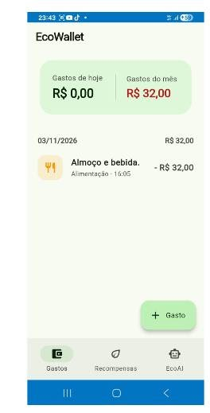
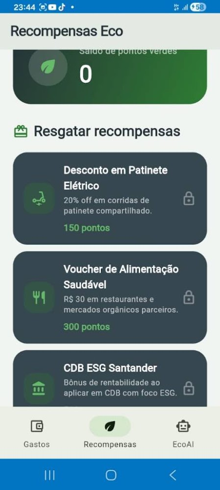
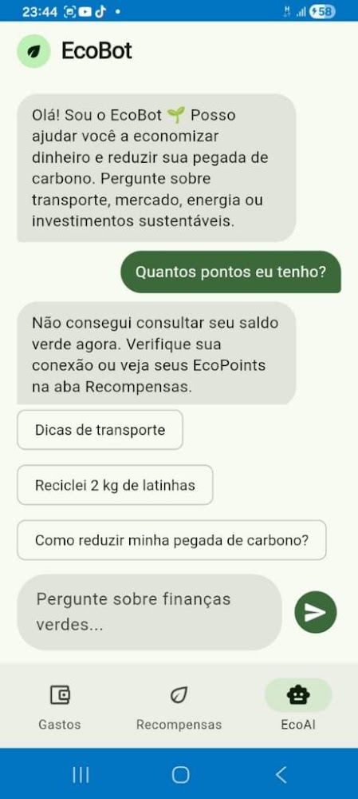

# EcoWallet

### Um ecossistema multiplataforma voltado para critérios ESG, finanças pessoais e sustentabilidade urbana.

## 📸 Demonstração Visual

| 💵 Controle de Gastos | 🌱 Recompensas Eco | 🤖 Assistente EcoBot |
| :---: | :---: | :---: |
|  |  |  |

**O EcoWallet foi selecionado e acelerado internacionalmente pelo programa Santander X Explorer, figurando entre os Top 100 Finalistas.**

O EcoWallet combina tecnologia e consciência socioambiental para apoiar decisões financeiras mais sustentáveis. O projeto integra recursos de gestão financeira, inteligência artificial e estimativas de impacto ambiental em uma experiência digital acessível e orientada ao consumo consciente.

## 📱 Funcionalidades Principais

- **Monitoramento inteligente de gastos:** acompanha e organiza gastos e transações, com recursos de automação para reduzir a necessidade de registro manual.
- **EcoBot com inteligência artificial:** oferece uma interface conversacional para apoiar consultas e apresentar orientações e insights relacionados a sustentabilidade e finanças pessoais, com integração a microsserviços de IA.
- **Estimativa de pegada de carbono:** associa atividades de consumo a estimativas de impacto ambiental e apresenta informações para incentivar escolhas mais conscientes.
- **Insights de consumo consciente:** transforma os dados disponíveis em sinais compreensíveis que ajudam o usuário a refletir sobre seus hábitos.
- **Gamificação sustentável:** utiliza pontuação, recompensas e metas para incentivar práticas sustentáveis no cotidiano.

> As estimativas e pontuações de carbono têm finalidade informativa e de engajamento. A comunicação de resultados como inventário ou declaração ESG exige metodologia, fronteiras, fontes de fatores de emissão e incertezas devidamente documentadas.

## 🏗️ Arquitetura e Engenharia de Software

O aplicativo é desenvolvido em Flutter e organiza suas responsabilidades em camadas de **Data**, **Domain** e **Presentation**, seguindo os princípios da Clean Architecture. Essa separação busca manter regras de negócio independentes de detalhes de interface, armazenamento e serviços externos, facilitando manutenção, evolução e testes.

- **Data:** concentra fontes de dados, modelos e repositórios responsáveis por obter, converter e persistir informações.
- **Domain:** reúne entidades, contratos de repositórios e regras de negócio, sem depender diretamente dos frameworks da interface ou de fornecedores externos.
- **Presentation:** contém telas, componentes e controladores que apresentam informações e recebem as interações do usuário.
- **BLoC/Cubit:** o pacote `flutter_bloc` organiza o estado da interface em fluxos previsíveis e reativos, separando eventos e estados da renderização visual.
- **Testes automatizados:** a biblioteca `bloc_test` apoia a validação de estados e transições dos componentes BLoC/Cubit. Testes unitários e de widgets complementam a verificação das regras e da experiência da aplicação.

### Competências Técnicas e Integração Full-Stack

- **Desenvolvimento mobile com Flutter e Dart:** experiência multiplataforma com organização em Clean Architecture, gerenciamento reativo de estado e captura automatizada de transações por notificações, reduzindo a latência entre a atividade financeira e sua apresentação no aplicativo.
- **Backend corporativo com Golang:** microsserviço REST organizado em camadas, com contratos OpenAPI, endpoints para resumos e séries temporais de carbono, validação de período, health checks e isolamento de acesso por empresa. A separação entre serviço e armazenamento permite evoluir a persistência sem acoplar as regras de negócio aos handlers.
- **EcoBot e inteligência artificial:** integração conversacional com serviços de IA e fluxos automatizados via webhooks/n8n, combinando engenharia de prompts com respostas contextualizadas para apoiar decisões financeiras e sustentáveis.
- **Nuvem e persistência:** Firebase oferece recursos de autenticação e armazenamento remoto para os fluxos do aplicativo. A arquitetura separa dados corporativos agregados do microsserviço Go dos dados operacionais do app, preparando a evolução para persistência gerenciada e processamento escalável.
- **Fluxo integrado de dados:** captura de transações no mobile, enriquecimento com estimativas de carbono e apresentação de insights formam um fluxo orientado a atualização rápida; as APIs REST permitem disponibilizar métricas agregadas às experiências administrativas B2B.

> **Estado do backend Go:** o serviço REST e seus contratos estão estruturados, mas o armazenamento atual é demonstrativo e em memória. Autenticação Firebase e persistência corporativa de produção ainda precisam ser conectadas antes de usar o microsserviço com dados reais.

## ⚙️ Persistência e Infraestrutura

- **Dados locais e cache:** `shared_preferences` oferece armazenamento assíncrono de pequenas preferências e valores locais, como configurações e dados simples de sessão. O uso de cache deve respeitar a natureza e a sensibilidade de cada informação.
- **Serviços em nuvem:** a integração com Firebase fornece componentes de infraestrutura para autenticação e persistência remota, conforme os serviços habilitados e configurados para o ambiente.
- **Configuração e segredos:** configurações específicas de ambiente podem ser carregadas por variáveis em um arquivo `.env` local, mantido fora do controle de versão. Chaves privadas e credenciais de produção devem ser fornecidas por mecanismos seguros de configuração, nunca adicionadas ao repositório.
- **Tratamento de erros:** falhas de rede, autenticação ou persistência devem ser tratadas explicitamente para preservar uma experiência clara, sem apresentar dados incompletos como se fossem resultados confirmados.
- **Automação com n8n:** fluxos automatizados podem conectar o aplicativo a serviços externos por meio de webhooks. A integração pode orquestrar tarefas de IA e processamento, usando engenharia de prompts para definir instruções e o formato esperado das respostas.
- **Privacidade:** integrações externas devem receber somente os dados necessários à operação. O tratamento de dados pessoais e financeiros deve considerar consentimento, segurança, retenção e requisitos aplicáveis de proteção de dados.

## 🚀 Como Executar

1. **Preparar o ambiente:** instale e configure o Flutter SDK e as ferramentas necessárias para a plataforma de destino, como Android Studio para execução em Android.
2. **Obter o projeto:** clone o repositório EcoWallet para sua máquina e abra a pasta do projeto no VS Code ou em outra IDE compatível com Flutter.
3. **Baixar as dependências:** execute a resolução de pacotes Flutter na raiz do projeto para instalar as dependências declaradas.
4. **Configurar integrações:** caso o ambiente utilize serviços externos, configure as variáveis de ambiente e os arquivos de configuração locais necessários. Não compartilhe nem versione credenciais.
5. **Iniciar o aplicativo:** selecione um dispositivo ou emulador compatível e execute o app pelo fluxo de execução do Flutter na IDE ou pelo terminal.
6. **Executar testes:** antes de contribuir ou publicar alterações, rode os testes automatizados do projeto e verifique eventuais avisos de análise estática.
